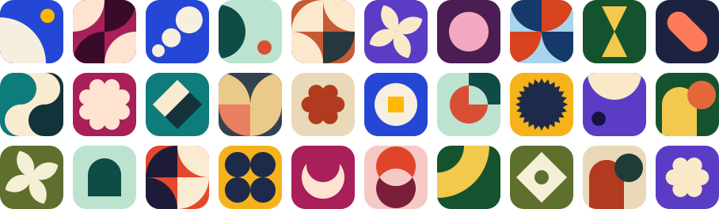
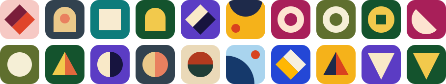
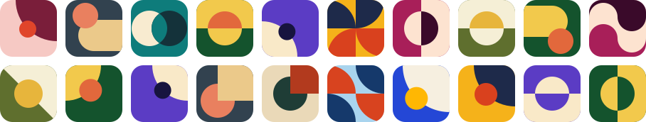
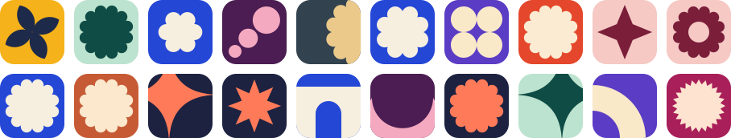

# Funcons

Procedurally generated icons for anything with an ID: small abstract artworks in three visual
families, drawn from a config you store instead of an image. Generation is
synchronous and local, with no network, canvas or image assets. The core has no
dependencies, and React is an optional peer for the component.



## The three families

**Geometric:** one bold motif with plenty of space.



**Abstract:** large overlapping shapes that run off the tile.



**Color:** one silhouette in strictly two colours, so the palette does the identifying.



## Use

```tsx
import { Funcon } from "funcons/react"

const icon = { version: 1, style: "geometric", seed: team.id }

<Funcon config={icon} size={32} />               // next to a visible name
<Funcon config={icon} size={32} label="Acme" />  // standing alone
```

Without React:

```ts
import { generateIcon, renderSvgString } from "funcons"

const svg = renderSvgString(generateIcon(icon), { size: 80 })
```

Persist the `{ version, style, seed }` config, never the SVG. Styles are
`geometric`, `abstract` and `color`. The seed is any string, and one seed keeps
its palette across all three styles. `Funcon` rounds its own corners; with
`renderSvgString`, clipping is up to you.

A config this build can't draw, such as one saved by a newer generator, makes
`generateIcon` throw a `RangeError` (check with `isSupportedIconConfig`).
`Funcon` draws a plain grey tile instead, so a stale tab can't crash a page.

## Stability

**A given `(version, style, seed)` draws the same artwork forever.** v1 is frozen.

Changing palettes, primitives, templates, the draw order or either renderer in a
way that alters output needs a new generator version alongside the old one: add
`src/versions/v2.ts` with its own copies of whatever changes, then add it to
`generate.ts`. Never update the reference snapshot to make a failing test pass.

### The v1 spec

| | |
|---|---|
| Seed to number | FNV-1a, 32 bits, over the seed's UTF-8 bytes |
| PRNG | Mulberry32 |
| Draw order | Palette, template, the template's own draws in code order, then the turn if the template is rotatable |
| Geometry | `+ - * /`, `sqrt` and a fixed cosine table, rounded to 2 decimals. Never `Math.sin` or `Math.cos`, whose low bits can differ by engine |

## Develop

```bash
pnpm install
pnpm preview     # contact sheet at http://localhost:5199
pnpm test
pnpm typecheck
pnpm build       # dist/
pnpm readme:images  # redraw the images above into docs/
```

Review changes on the contact sheet at 80, 32 and 24px. Fix problems in the
templates, never by special-casing seeds. Each family's header comment lists the
shapes kept out because they read as something else (a play button, a stop sign,
the letters U and C); keep new templates clear of those too.

## Sponsors

Funcons is built and maintained with support from:

<p>
  <a href="https://bench47.com"></a>
  &nbsp;&nbsp;&nbsp;&nbsp;
  <a href="https://sendops.dev"><picture><source media="(prefers-color-scheme: dark)" srcset="docs/sponsors/sendops-dark.svg"></picture></a>
</p>

## License

Copyright 2026 AltaCoda. Licensed under the [Apache License, Version 2.0](LICENSE).
